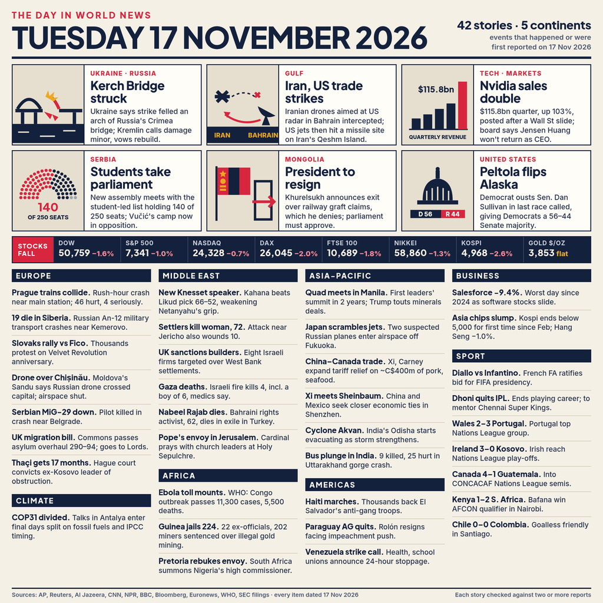

# The Day in World News: Tuesday 17 November 2026

[](https://make.fun/bounty/news-image-20261117)
[](https://make.fun/bounty/news-image-20261117)
[](https://make.fun/bounty/news-image-20261117)

Entry for the make.fun bounty `news-image-20261117`: one 1024×1024 front page of the world's news on Tuesday 17 November 2026.



## What it shows

The page is laid out like a newspaper front page. It covers 42 stories from five continents, every one of which happened or was first reported on 17 November 2026:

- **Six illustrated leads.** Kerch Bridge struck · Iran and the US trade strikes (Bahrain / Qeshm) · Nvidia's $115.8bn quarter, with the board saying Jensen Huang won't return · Serbia's student-led list taking 140 of 250 seats · Mongolia's president to resign · Peltola flips Alaska, giving Democrats a 56–44 Senate.
- **Markets strip.** Closes for the Dow, S&P 500, Nasdaq, DAX, FTSE 100, Nikkei and Kospi, plus gold.
- **Short items by section:**
  - Europe (7)
  - Climate (1)
  - Middle East (6)
  - Africa (3)
  - Asia-Pacific (6)
  - Americas (3)
  - Business (2)
  - Sport (7)

Each story was checked against at least two independent reports. Items that turned out to belong to the 16th or 18th were dropped. [facts.md](facts.md) lists every fact with its source URLs, plus the stories that were checked and rejected.

## How it is built

- `index.html` is the page itself: HTML/CSS with hand-drawn inline SVG illustrations (no photos, faces or logos). It uses Plus Jakarta Sans and Inter from `fonts/`, in a palette of paper, ink, red and gold.
- `entry.png` is rendered at 2× in headless Chrome, then downscaled to 1024×1024 with Lanczos resampling so small text stays sharp:
  ```
  chrome --headless=new --no-sandbox --disable-gpu --hide-scrollbars --force-device-scale-factor=2 \
         --window-size=1024,1024 --screenshot=big.png file://$PWD/index.html
  python3 -c "from PIL import Image; Image.open('big.png').convert('RGB').resize((1024,1024), Image.LANCZOS).save('entry.png', optimize=True)"
  ```
  The result is about 730 KB, under the 1 MiB limit.
- `main.ts` (Node 22, standard library only) copies `entry.png` to `/output/entry.png`, or to `$MAKEFUN_OUTPUT_DIR` when that is set:
  ```
  mkdir -p out && MAKEFUN_OUTPUT_DIR=out node main.ts
  ```

## License

See [LICENSE](LICENSE).
